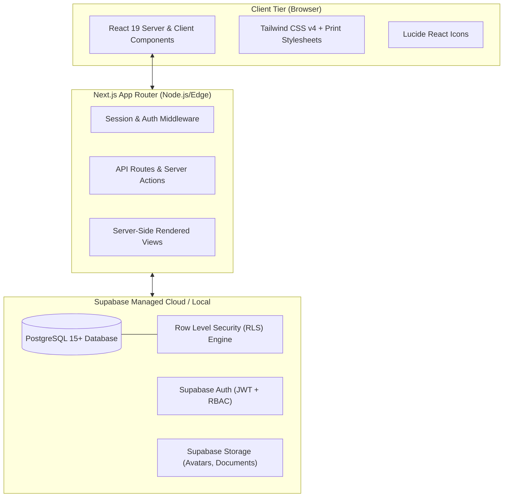
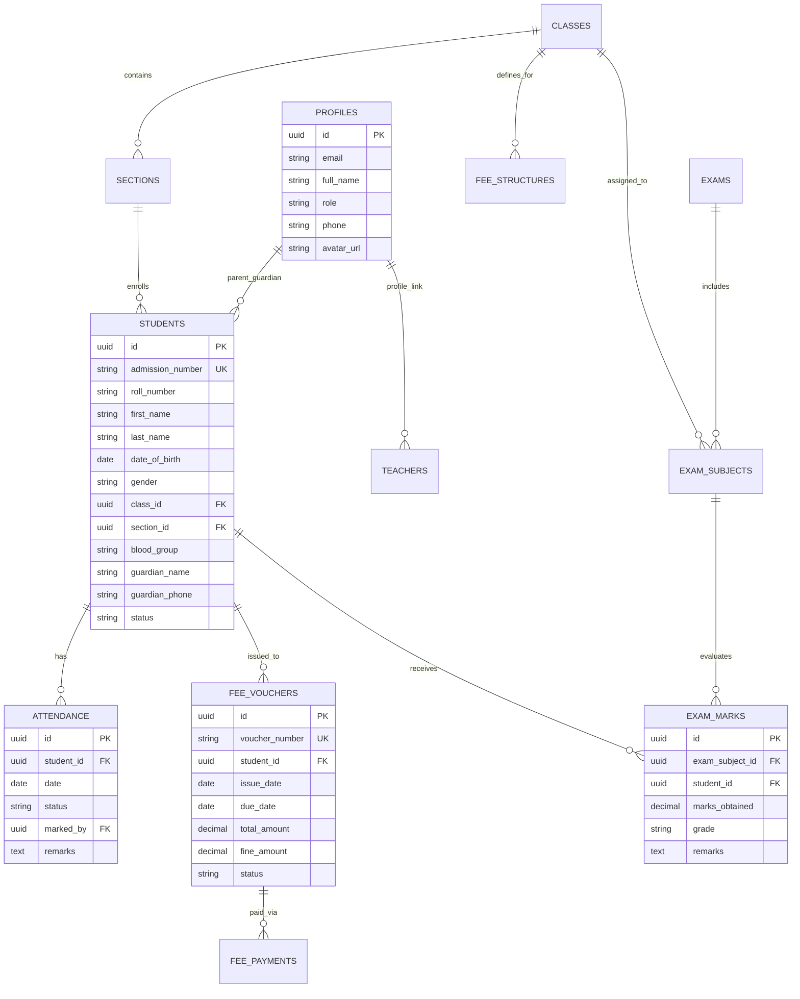

# 🎓 School Management Software — System Blueprint & Architecture Specification

> **Version**: 1.0.0  
> **Framework**: Next.js 16 (App Router, React 19)  
> **Styling**: Tailwind CSS v4  
> **Database & Auth**: Supabase (PostgreSQL, Supabase Auth, Row Level Security, Storage)  
> **Type Safety**: TypeScript Strict Mode  

---

## 📑 Table of Contents
1. [Executive Overview & Objectives](#1-executive-overview--objectives)
2. [Technology Stack & System Architecture](#2-technology-stack--system-architecture)
3. [Database Schema & Supabase Architecture](#3-database-schema--supabase-architecture)
4. [Role-Based Access Control (RBAC) & Security Policies](#4-role-based-access-control-rbac--security-policies)
5. [Core Module 1: Student & Teacher Admissions](#5-core-module-1-student--teacher-admissions)
6. [Core Module 2: Daily Attendance Management](#6-core-module-2-daily-attendance-management)
7. [Core Module 3: Fee Tracking & Printable Vouchers](#7-core-module-3-fee-tracking--printable-vouchers)
8. [Core Module 4: Exam Marks & Printable Report Cards](#8-core-module-4-exam-marks--printable-report-cards)
9. [Project Directory Layout (App Router)](#9-project-directory-layout-app-router)
10. [Print Styling & Document Generation Specifications](#10-print-styling--document-generation-specifications)
11. [Implementation Roadmap & Milestones](#11-implementation-roadmap--milestones)

---

## 1. Executive Overview & Objectives

The **School Management Software (SMS)** is an enterprise-grade, highly responsive web application designed for modern educational institutions (K-12 schools, academies, and colleges). It streamlines administrative overhead, tracks student lifecycles, automates billing and attendance, and produces standardized, printable academic documents (fee challans and official report cards).

### Key Architectural Tenets
- **Server-First Modern React**: Leveraging Next.js App Router, Server Components for fast page loads and SEO, and Server Actions for secure data mutations.
- **Strict Multi-Role Security**: Enforced via Supabase Row-Level Security (RLS) guaranteeing that students, teachers, accountants, and administrators only access permissible data.
- **Offline-Ready Printable Artifacts**: Pixel-perfect CSS print stylesheets (`@media print`) and layout grids tailored to standard A4/Letter papers for Fee Vouchers (3-copy bank challans) and Official Academic Report Cards.
- **Relational Data Integrity**: Strict foreign keys, composite unique constraints, audit timestamps, and automated database triggers in PostgreSQL.

---

## 2. Technology Stack & System Architecture



| Layer | Technology | Version | Purpose |
| :--- | :--- | :--- | :--- |
| **Frontend Framework** | Next.js (App Router) | 16.x | Server Components, Server Actions, Dynamic Layouts |
| **UI Library** | React | 19.x | Declarative UI rendering |
| **Styling** | Tailwind CSS | 4.x | Modern utility-first CSS & `@media print` rules |
| **Icons** | Lucide React | Latest | Clean, accessible SVG iconography |
| **Backend & DB** | Supabase (PostgreSQL) | Latest | Managed Relational DB, Auth, Storage, and Realtime |
| **Auth** | Supabase Auth (`@supabase/ssr`) | Latest | Cookie-based SSR authentication & session management |
| **Validation** | TypeScript & Zod | Strict | End-to-end schema validation |

---

## 3. Database Schema & Supabase Architecture

The database is built on PostgreSQL with strict relational schemas, custom enums, and foreign key cascades.



### Complete Database Schema (SQL DDL)

```sql
-- 1. Enable UUID Extension
CREATE EXTENSION IF NOT EXISTS "uuid-ossp";

-- 2. Custom Enumerations
CREATE TYPE user_role AS ENUM ('super_admin', 'admin', 'teacher', 'accountant', 'student', 'parent');
CREATE TYPE gender_type AS ENUM ('male', 'female', 'other');
CREATE TYPE admission_status AS ENUM ('active', 'suspended', 'graduated', 'withdrawn');
CREATE TYPE attendance_status AS ENUM ('present', 'absent', 'late', 'half_day', 'excused');
CREATE TYPE fee_status AS ENUM ('unpaid', 'partially_paid', 'paid', 'overdue', 'cancelled');
CREATE TYPE payment_method AS ENUM ('cash', 'bank_transfer', 'online_gateway', 'cheque');

-- 3. User Profiles (Extending auth.users)
CREATE TABLE public.profiles (
    id UUID PRIMARY KEY REFERENCES auth.users(id) ON DELETE CASCADE,
    email TEXT NOT NULL UNIQUE,
    full_name TEXT NOT NULL,
    role user_role NOT NULL DEFAULT 'student',
    phone TEXT,
    avatar_url TEXT,
    created_at TIMESTAMPTZ DEFAULT NOW(),
    updated_at TIMESTAMPTZ DEFAULT NOW()
);

-- 4. Academic Structure: Classes & Sections
CREATE TABLE public.classes (
    id UUID PRIMARY KEY DEFAULT uuid_generate_v4(),
    name TEXT NOT NULL, -- e.g., 'Grade 10', 'O-Levels Year 1'
    numeric_order INT NOT NULL,
    created_at TIMESTAMPTZ DEFAULT NOW()
);

CREATE TABLE public.sections (
    id UUID PRIMARY KEY DEFAULT uuid_generate_v4(),
    class_id UUID NOT NULL REFERENCES public.classes(id) ON DELETE CASCADE,
    name TEXT NOT NULL, -- e.g., 'Section A', 'Lotus'
    capacity INT DEFAULT 40,
    created_at TIMESTAMPTZ DEFAULT NOW(),
    UNIQUE(class_id, name)
);

-- 5. Teachers Table
CREATE TABLE public.teachers (
    id UUID PRIMARY KEY DEFAULT uuid_generate_v4(),
    profile_id UUID REFERENCES public.profiles(id) ON DELETE SET NULL,
    employee_id TEXT NOT NULL UNIQUE,
    first_name TEXT NOT NULL,
    last_name TEXT NOT NULL,
    email TEXT NOT NULL,
    phone TEXT NOT NULL,
    qualification TEXT,
    specialization TEXT,
    joining_date DATE NOT NULL,
    salary DECIMAL(10, 2),
    status TEXT DEFAULT 'active',
    created_at TIMESTAMPTZ DEFAULT NOW()
);

-- 6. Students Table
CREATE TABLE public.students (
    id UUID PRIMARY KEY DEFAULT uuid_generate_v4(),
    profile_id UUID REFERENCES public.profiles(id) ON DELETE SET NULL,
    admission_number TEXT NOT NULL UNIQUE,
    roll_number TEXT NOT NULL,
    first_name TEXT NOT NULL,
    last_name TEXT NOT NULL,
    gender gender_type NOT NULL,
    date_of_birth DATE NOT NULL,
    class_id UUID NOT NULL REFERENCES public.classes(id),
    section_id UUID NOT NULL REFERENCES public.sections(id),
    blood_group TEXT,
    emergency_contact TEXT,
    address TEXT,
    guardian_name TEXT NOT NULL,
    guardian_relation TEXT NOT NULL,
    guardian_phone TEXT NOT NULL,
    guardian_email TEXT,
    admission_date DATE DEFAULT CURRENT_DATE,
    status admission_status DEFAULT 'active',
    avatar_url TEXT,
    created_at TIMESTAMPTZ DEFAULT NOW(),
    updated_at TIMESTAMPTZ DEFAULT NOW(),
    UNIQUE(class_id, section_id, roll_number)
);

-- 7. Daily Attendance Table
CREATE TABLE public.attendance (
    id UUID PRIMARY KEY DEFAULT uuid_generate_v4(),
    student_id UUID NOT NULL REFERENCES public.students(id) ON DELETE CASCADE,
    class_id UUID NOT NULL REFERENCES public.classes(id),
    section_id UUID NOT NULL REFERENCES public.sections(id),
    date DATE NOT NULL,
    status attendance_status NOT NULL DEFAULT 'present',
    remarks TEXT,
    marked_by UUID REFERENCES public.profiles(id),
    created_at TIMESTAMPTZ DEFAULT NOW(),
    updated_at TIMESTAMPTZ DEFAULT NOW(),
    UNIQUE(student_id, date)
);

-- 8. Fee Structure Specification
CREATE TABLE public.fee_structures (
    id UUID PRIMARY KEY DEFAULT uuid_generate_v4(),
    class_id UUID NOT NULL REFERENCES public.classes(id) ON DELETE CASCADE,
    title TEXT NOT NULL, -- e.g., 'Monthly Tuition 2026'
    tuition_fee DECIMAL(10, 2) NOT NULL DEFAULT 0.00,
    computer_lab_fee DECIMAL(10, 2) DEFAULT 0.00,
    library_fee DECIMAL(10, 2) DEFAULT 0.00,
    sports_fee DECIMAL(10, 2) DEFAULT 0.00,
    exam_fee DECIMAL(10, 2) DEFAULT 0.00,
    total_amount DECIMAL(10, 2) GENERATED ALWAYS AS (
        tuition_fee + computer_lab_fee + library_fee + sports_fee + exam_fee
    ) STORED,
    created_at TIMESTAMPTZ DEFAULT NOW()
);

-- 9. Fee Vouchers / Challans
CREATE TABLE public.fee_vouchers (
    id UUID PRIMARY KEY DEFAULT uuid_generate_v4(),
    voucher_number TEXT NOT NULL UNIQUE,
    student_id UUID NOT NULL REFERENCES public.students(id) ON DELETE CASCADE,
    fee_structure_id UUID REFERENCES public.fee_structures(id),
    billing_month DATE NOT NULL, -- Represented as first day of month (YYYY-MM-01)
    issue_date DATE NOT NULL DEFAULT CURRENT_DATE,
    due_date DATE NOT NULL,
    base_amount DECIMAL(10, 2) NOT NULL,
    fine_after_due_date DECIMAL(10, 2) DEFAULT 0.00,
    paid_amount DECIMAL(10, 2) DEFAULT 0.00,
    status fee_status DEFAULT 'unpaid',
    notes TEXT,
    created_at TIMESTAMPTZ DEFAULT NOW(),
    updated_at TIMESTAMPTZ DEFAULT NOW()
);

-- 10. Fee Payments History
CREATE TABLE public.fee_payments (
    id UUID PRIMARY KEY DEFAULT uuid_generate_v4(),
    voucher_id UUID NOT NULL REFERENCES public.fee_vouchers(id) ON DELETE CASCADE,
    payment_date TIMESTAMPTZ DEFAULT NOW(),
    amount_paid DECIMAL(10, 2) NOT NULL,
    method payment_method NOT NULL DEFAULT 'cash',
    transaction_ref TEXT,
    recorded_by UUID REFERENCES public.profiles(id),
    receipt_number TEXT NOT NULL UNIQUE,
    created_at TIMESTAMPTZ DEFAULT NOW()
);

-- 11. Examinations Table
CREATE TABLE public.exams (
    id UUID PRIMARY KEY DEFAULT uuid_generate_v4(),
    title TEXT NOT NULL, -- e.g., 'Midterm Examination 2026-27'
    term TEXT NOT NULL, -- 'First Term', 'Midterm', 'Final'
    start_date DATE NOT NULL,
    end_date DATE NOT NULL,
    academic_year TEXT NOT NULL,
    is_published BOOLEAN DEFAULT FALSE,
    created_at TIMESTAMPTZ DEFAULT NOW()
);

-- 12. Exam Subjects Setup
CREATE TABLE public.exam_subjects (
    id UUID PRIMARY KEY DEFAULT uuid_generate_v4(),
    exam_id UUID NOT NULL REFERENCES public.exams(id) ON DELETE CASCADE,
    class_id UUID NOT NULL REFERENCES public.classes(id) ON DELETE CASCADE,
    subject_name TEXT NOT NULL, -- 'Mathematics', 'English Literature'
    total_marks DECIMAL(5, 2) NOT NULL DEFAULT 100.00,
    passing_marks DECIMAL(5, 2) NOT NULL DEFAULT 40.00,
    exam_date DATE,
    created_at TIMESTAMPTZ DEFAULT NOW(),
    UNIQUE(exam_id, class_id, subject_name)
);

-- 13. Student Exam Marks
CREATE TABLE public.exam_marks (
    id UUID PRIMARY KEY DEFAULT uuid_generate_v4(),
    exam_subject_id UUID NOT NULL REFERENCES public.exam_subjects(id) ON DELETE CASCADE,
    student_id UUID NOT NULL REFERENCES public.students(id) ON DELETE CASCADE,
    marks_obtained DECIMAL(5, 2) NOT NULL CHECK (marks_obtained >= 0),
    grade TEXT,
    remarks TEXT,
    entered_by UUID REFERENCES public.profiles(id),
    created_at TIMESTAMPTZ DEFAULT NOW(),
    updated_at TIMESTAMPTZ DEFAULT NOW(),
    UNIQUE(exam_subject_id, student_id)
);

-- 14. Grading Scale Reference
CREATE TABLE public.grading_scales (
    id UUID PRIMARY KEY DEFAULT uuid_generate_v4(),
    grade TEXT NOT NULL UNIQUE, -- 'A+', 'A', 'B', 'C', 'D', 'F'
    min_percentage DECIMAL(5, 2) NOT NULL,
    max_percentage DECIMAL(5, 2) NOT NULL,
    gpa_point DECIMAL(3, 2) NOT NULL,
    description TEXT
);
```

---

## 4. Role-Based Access Control (RBAC) & Security Policies

Row-Level Security (RLS) is activated on all sensitive tables to isolate student records and enforce strict institutional workflows.

```sql
-- Enable RLS across key tables
ALTER TABLE public.profiles ENABLE ROW LEVEL SECURITY;
ALTER TABLE public.students ENABLE ROW LEVEL SECURITY;
ALTER TABLE public.teachers ENABLE ROW LEVEL SECURITY;
ALTER TABLE public.attendance ENABLE ROW LEVEL SECURITY;
ALTER TABLE public.fee_vouchers ENABLE ROW LEVEL SECURITY;
ALTER TABLE public.fee_payments ENABLE ROW LEVEL SECURITY;
ALTER TABLE public.exam_marks ENABLE ROW LEVEL SECURITY;

-- Helper Function to Extract Current User Role
CREATE OR REPLACE FUNCTION public.current_user_role()
RETURNS user_role AS $$
    SELECT role FROM public.profiles WHERE id = auth.uid();
$$ LANGUAGE sql STABLE SECURITY DEFINER;

-- 1. Profiles Policy
CREATE POLICY "Users can read own profile; Admins read all" ON public.profiles
    FOR SELECT USING (auth.uid() = id OR public.current_user_role() IN ('super_admin', 'admin'));

-- 2. Students Policy
CREATE POLICY "Staff can view students; Parents/Students view own" ON public.students
    FOR SELECT USING (
        public.current_user_role() IN ('super_admin', 'admin', 'teacher', 'accountant')
        OR profile_id = auth.uid()
    );

CREATE POLICY "Only Admins can insert/update students" ON public.students
    FOR ALL USING (public.current_user_role() IN ('super_admin', 'admin'));

-- 3. Attendance Policy
CREATE POLICY "Staff can view all attendance; Students view own" ON public.attendance
    FOR SELECT USING (
        public.current_user_role() IN ('super_admin', 'admin', 'teacher')
        OR student_id IN (SELECT id FROM public.students WHERE profile_id = auth.uid())
    );

CREATE POLICY "Teachers and Admins can mark attendance" ON public.attendance
    FOR INSERT WITH CHECK (public.current_user_role() IN ('super_admin', 'admin', 'teacher'));

CREATE POLICY "Teachers and Admins can update attendance" ON public.attendance
    FOR UPDATE USING (public.current_user_role() IN ('super_admin', 'admin', 'teacher'));

-- 4. Fee Vouchers Policy
CREATE POLICY "Accountants and Admins manage vouchers" ON public.fee_vouchers
    FOR ALL USING (public.current_user_role() IN ('super_admin', 'admin', 'accountant'));

CREATE POLICY "Students and Parents view own vouchers" ON public.fee_vouchers
    FOR SELECT USING (
        student_id IN (SELECT id FROM public.students WHERE profile_id = auth.uid())
    );

-- 5. Exam Marks Policy
CREATE POLICY "Admins and Teachers view and edit marks" ON public.exam_marks
    FOR ALL USING (public.current_user_role() IN ('super_admin', 'admin', 'teacher'));

CREATE POLICY "Students view own published marks" ON public.exam_marks
    FOR SELECT USING (
        student_id IN (SELECT id FROM public.students WHERE profile_id = auth.uid())
        AND exam_subject_id IN (
            SELECT es.id FROM public.exam_subjects es
            JOIN public.exams e ON es.exam_id = e.id
            WHERE e.is_published = TRUE
        )
    );
```

---

## 5. Core Module 1: Student & Teacher Admissions

### Functional Requirements
- **Admission Pipeline**: Status progression from `Application Submitted` $\to$ `Interview/Review` $\to$ `Approved/Enrolled`.
- **Automated Identifier Generation**:
  - Student Admission Number: `ADM-{YEAR}-{CLASS_ORDER}-{0001}` (e.g., `ADM-2026-10-0042`).
  - Teacher Employee ID: `EMP-{YEAR}-{001}`.
- **Student Profile Management**:
  - Comprehensive bio, emergency contact, health details (blood group, allergies).
  - Parent/Guardian linkage (name, relation, phone, email).
  - Class and Section assignment with live capacity validation.
  - Image upload to Supabase Storage bucket (`avatars/students`).
- **Teacher Onboarding**:
  - Qualifications, departmental assignment, subjects taught, salary & joining date.

### UI & UX Flow
1. **Admissions Hub (`/admissions`)**:
   - Quick statistics cards: Total Admitted, Active Applications, Available Class Seats.
   - Live search filter by Student Name, Admission Number, Class, and Section.
2. **New Admission Form (`/admissions/student/new`)**:
   - 3-step wizard with Zod validation:
     - *Step 1*: Personal & Medical Information.
     - *Step 2*: Academic Placement (Grade, Section, Roll Number).
     - *Step 3*: Guardian & Emergency Contacts.

---

## 6. Core Module 2: Daily Attendance Management

### Functional Requirements
- **Class-Roster Rapid Mark System**:
  - Grid view of enrolled students for selected `Class`, `Section`, and `Date`.
  - One-click bulk action: `Mark All Present`.
  - Individual toggle options: `Present` (Green), `Absent` (Red), `Late` (Amber), `Excused` (Blue).
  - Automatic duplicate prevention (Unique index on `student_id + date`).
- **Absentee Tracking & Notifications**:
  - Instant list of today's absentees.
  - SMS/WhatsApp/Email notification payload generator for guardians.
- **Attendance Analytics**:
  - Student monthly attendance rate percentage formula:
    $$\text{Attendance Rate} = \left( \frac{\text{Present Days} + (\text{Late Days} \times 0.5)}{\text{Total Working Days}} \right) \times 100$$
  - Automatic visual warning badge for students below the institutional threshold (e.g., $< 75\%$).

---

## 7. Core Module 3: Fee Tracking & Printable Vouchers

### Functional Requirements
- **Dynamic Fee Structures**:
  - Configurable fee items per grade level: Tuition, Lab, Sports, Library, Exams.
- **Bulk Monthly Voucher Generation**:
  - Generate vouchers for entire grade or section in a single batch job.
  - Generates unique challan/voucher ID: `VCH-YYYYMM-{STUDENT_ROLL}`.
  - Due date assignment and automatic overdue fine computation.
- **Payment Processing**:
  - Record full or partial payments across cash, bank, or electronic slip.
  - Instant receipt generation with sequential receipt numbers.
- **Standard 3-Part Printable Fee Challan**:
  - Bank standard tri-fold layout on a single A4 landscape page containing:
    1. **Bank Copy** (Retained by receiving bank teller)
    2. **School Copy** (Submitted to school accounts desk)
    3. **Student Copy** (Retained by parent/student as proof of payment)
  - Features high-contrast typography, student details, itemized fee breakdown, due date, barcode / QR code container, and bank stamp boxes.

---

## 8. Core Module 4: Exam Marks & Printable Report Cards

### Functional Requirements
- **Examination Term Management**:
  - Setup academic term (e.g., Midterms, Finals), exam schedule, and subject allocations per grade.
- **Grade-Sheet Matrix Entry**:
  - Teacher spreadsheet-like mark entry interface per subject.
  - Instant validation against `total_marks` and `passing_marks`.
- **Automated Computations**:
  - Percentage: $\frac{\sum \text{Marks Obtained}}{\sum \text{Total Marks}} \times 100$
  - Dynamic Letter Grade & GPA calculation using the configurable `grading_scales` table:
    - $90\% - 100\% \to \text{A+} \ (4.0)$
    - $80\% - 89\% \to \text{A} \ (3.7)$
    - $70\% - 79\% \to \text{B} \ (3.0)$
    - $60\% - 69\% \to \text{C} \ (2.0)$
    - $50\% - 59\% \to \text{D} \ (1.0)$
    - Below $50\% \to \text{F} \ (0.0)$
  - Automatic Class Rank / Position calculation.
- **Official Printable Academic Report Card**:
  - Single-page A4 Portrait layout.
  - Institutional header: School crest, name, contact, accreditation badge.
  - Student Bio: Name, Roll Number, Class, Section, Term, Academic Year.
  - Detailed Academic Table: Subject, Max Marks, Passing Marks, Marks Obtained, Grade, Teacher Remarks.
  - Attendance Summary Box: Total Working Days vs Days Attended.
  - Result Summary: Total Marks, Percentage, Final Grade, Position in Class.
  - Sign-off section: Class Teacher Signature, Principal Signature, Official School Seal stamp box.

---

## 9. Project Directory Layout (App Router)

```
school-app/
├── public/
│   ├── images/              # School crest, seal, placeholders
│   └── favicon.ico
├── src/
│   ├── app/
│   │   ├── (auth)/
│   │   │   └── login/
│   │   │       └── page.tsx           # Institutional authentication screen
│   │   ├── (dashboard)/
│   │   │   ├── layout.tsx             # Dashboard shell with sidebar & header
│   │   │   ├── page.tsx               # Analytics & executive KPI overview
│   │   │   ├── admissions/
│   │   │   │   ├── page.tsx           # Student & teacher directory
│   │   │   │   ├── student/new/page.tsx # Student admission wizard
│   │   │   │   └── teacher/new/page.tsx # Teacher onboarding form
│   │   │   ├── attendance/
│   │   │   │   ├── page.tsx           # Daily roster attendance marking
│   │   │   │   └── reports/page.tsx   # Monthly attendance analytics
│   │   │   ├── fees/
│   │   │   │   ├── page.tsx           # Billing dashboard & fee records
│   │   │   │   ├── generate/page.tsx  # Bulk monthly voucher generator
│   │   │   │   └── voucher/[id]/page.tsx # Printable 3-part bank challan
│   │   │   └── exams/
│   │   │       ├── page.tsx           # Exam sessions & terms list
│   │   │       ├── marks/page.tsx     # Teacher spreadsheet marks entry
│   │   │       └── report-card/[studentId]/[examId]/page.tsx # Official Printable Report Card
│   │   ├── globals.css                # Tailwind CSS v4 & @media print setup
│   │   └── layout.tsx                 # Root HTML shell & fonts
│   ├── components/
│   │   ├── layout/
│   │   │   ├── Sidebar.tsx            # Navigation links per role
│   │   │   └── Header.tsx             # User profile, notifications, search
│   │   ├── admissions/
│   │   │   └── AdmissionForm.tsx      # Multi-step validated form
│   │   ├── attendance/
│   │   │   └── AttendanceGrid.tsx     # Interactive marking roster
│   │   ├── fees/
│   │   │   └── PrintableChallan.tsx   # 3-fold Bank Challan (A4 Landscape)
│   │   ├── exams/
│   │   │   ├── MarksEntryTable.tsx    # Spreadsheet-like fast entry
│   │   │   └── PrintableReportCard.tsx # Official Report Card (A4 Portrait)
│   │   └── ui/                        # Reusable primitives (Buttons, Badges, Modals)
│   ├── lib/
│   │   ├── supabase/
│   │   │   ├── client.ts              # Browser Supabase client
│   │   │   ├── server.ts              # Server-side Supabase client (SSR)
│   │   │   └── middleware.ts          # Session refresh helper
│   │   ├── utils.ts                   # Formatting (currency, date, grades)
│   │   └── validations.ts             # Zod schemas for forms
│   ├── types/
│   │   └── database.types.ts          # TypeScript interfaces for DB entities
│   └── middleware.ts                  # Root auth route protection
├── supabase/
│   └── schema.sql                     # Full PostgreSQL DDL & Seed data
├── .env.local.example                 # Required Supabase API credentials
├── package.json
├── tsconfig.json
└── GEMINI.md                          # This blueprint file
```

---

## 10. Print Styling & Document Generation Specifications

Both **Fee Vouchers** and **Report Cards** must render directly inside the browser and be printable via native `window.print()` without relying on heavy external PDF libraries.

### 1. Print Media CSS Rules (`globals.css`)
```css
@media print {
  /* Hide all dashboard chrome: sidebar, headers, buttons, navigation */
  aside, header, nav, .no-print, button {
    display: none !important;
  }

  body {
    background: #ffffff !important;
    color: #000000 !important;
    font-size: 11pt;
    margin: 0;
    padding: 0;
    -webkit-print-color-adjust: exact !important;
    print-color-adjust: exact !important;
  }

  .print-page {
    width: 100%;
    margin: 0 auto;
    page-break-after: always;
  }

  /* Specific rule for A4 Landscape Tri-fold Fee Challan */
  .challan-sheet {
    display: grid;
    grid-template-columns: repeat(3, 1fr);
    gap: 16px;
    height: 100vh;
  }

  /* Specific rule for A4 Portrait Report Card */
  .report-card-sheet {
    width: 210mm;
    min-height: 297mm;
    padding: 15mm;
    margin: auto;
  }
}
```

### 2. Challan Tri-Fold Grid
The fee voucher is rendered as a 3-column layout:
- **Left Column**: Bank Copy (Includes Bank Account details, teller sign, stamp box)
- **Middle Column**: School Accounts Copy
- **Right Column**: Student / Guardian Copy

---

## 11. Implementation Roadmap & Milestones

- [x] **Milestone 1: Foundations & Scaffolding**
  - Scaffold Next.js App Router with TypeScript & Tailwind CSS.
  - Install `@supabase/supabase-js`, `@supabase/ssr`, and `lucide-react`.
  - Establish complete architectural blueprint (`GEMINI.md`).
- [ ] **Milestone 2: Database & Authentication Layer**
  - Execute PostgreSQL schema (`supabase/schema.sql`) on Supabase instance.
  - Configure Supabase SSR client utilities (`src/lib/supabase/client.ts` & `server.ts`).
  - Create login screen and session validation middleware.
- [ ] **Milestone 3: Module 1 — Student & Teacher Admissions**
  - Build admissions list with filtering and search.
  - Build multi-step admission wizard with image upload to Supabase Storage.
- [ ] **Milestone 4: Module 2 — Daily Attendance Roster**
  - Implement class/section date-based roster table with one-click bulk status toggling.
  - Compute monthly attendance rates with low-attendance warnings.
- [ ] **Milestone 5: Module 3 — Fee Tracking & 3-Part Printable Voucher**
  - Build fee structures manager and bulk voucher generation.
  - Implement pixel-perfect printable A4 Landscape tri-fold bank challan.
  - Build payment logging interface with partial payment & receipt generation.
- [ ] **Milestone 6: Module 4 — Exam Marks & Printable Report Cards**
  - Build exam term setup and spreadsheet-style grade entry matrix.
  - Automate percentage, GPA, grade letter, and class rank calculations.
  - Implement printable official A4 Portrait report card with school seal and signature boxes.
